  
  &nbsp;&nbsp;&nbsp;
  
  &nbsp;&nbsp;&nbsp;
  

 

> **Full Stack Developer** building scalable web applications with modern JavaScript ecosystems.
> Currently architecting micro-frontend & SSO solutions at **Irtiqa Business Solutions**.
> BS Computer Science — COMSATS University, Islamabad.

 

## Stack

**Languages & Runtime**

<kbd>JavaScript</kbd> &nbsp; <kbd>TypeScript</kbd> &nbsp; <kbd>HTML5</kbd> &nbsp; <kbd>CSS3</kbd> &nbsp; <kbd>GraphQL</kbd>

**Frameworks**

<kbd>React</kbd> &nbsp; <kbd>Next.js</kbd> &nbsp; <kbd>Node.js</kbd> &nbsp; <kbd>Express.js</kbd> &nbsp; <kbd>NestJS</kbd> &nbsp; <kbd>MongoDB</kbd> &nbsp; <kbd>Supabase</kbd>

**UI & Design Systems**

<kbd>Tailwind CSS</kbd> &nbsp; <kbd>SCSS</kbd> &nbsp; <kbd>Material UI</kbd> &nbsp; <kbd>Shadcn/ui</kbd> &nbsp; <kbd>Ant Design</kbd> &nbsp; <kbd>NextUI</kbd> &nbsp; <kbd>Storybook</kbd>

**Cloud & Tooling**

<kbd>AWS</kbd> &nbsp; <kbd>GCP</kbd> &nbsp; <kbd>Vercel</kbd> &nbsp; <kbd>Docker</kbd> &nbsp; <kbd>Stripe</kbd> &nbsp; <kbd>Git</kbd> &nbsp; <kbd>Postman</kbd> &nbsp; <kbd>Swagger</kbd>

 

## Experience

**Irtiqa Business Solutions** — Full Stack Developer &nbsp; `Sep 2023 – Present`
 Micro-frontend & micro-services architecture · SSO with React · REST APIs with NestJS · AWS & Vercel deployments

**Xint Solutions** — Frontend Developer &nbsp; `Mar 2023 – Aug 2023`
 React/Next.js feature development · Google Maps integration · Clean, standards-driven code

**Selteq IT Solutions** — Full Stack Developer &nbsp; `Mar 2021 – Mar 2023`
 Booking system APIs with Node.js · Admin dashboards · Reusable component architecture

 

## Featured Projects

<table>
<tr>
<td width="100%" valign="top">

### <a href="https://beta.traderos.ai">TraderOS</a> &nbsp; 🔥 Active &nbsp; <i>FinTech / AI Trading Platform</i>
React · TypeScript · Vite · FastAPI · NestJS · Supabase

AI trading workspace for chat-driven research, market reports, a TradingView extension, and journal workflows. Primary frontend engineer on the product — shipped the live React app (Harness workspace & chat, reports, TradingView extension) and the NestJS billing/auth surfaces running on [beta.traderos.ai](https://beta.traderos.ai).

</td>
</tr>
<tr>
<td width="100%" valign="top">

### <a href="https://eventooz.com">Eventooz</a> &nbsp; <i>Events / SaaS</i>
Next.js · TypeScript · NestJS · Supabase · Razorpay · Tailwind CSS · AWS · Terraform

Event platform for India — attendees discover local events, organizers run registrations, paid tickets, QR passes and check-in. Built the attendee & organizer web app, the NestJS API and the AWS deployment: event discovery, Razorpay checkout, QR passes, the organizer dashboard, and production hosting on [eventooz.com](https://eventooz.com).

</td>
</tr>
</table>

<table>
<tr>
<td width="50%" valign="top">

### LYCA Audit Tool
TypeScript · React · NestJS · MongoDB · Redux · RTK Query

Full-stack audit platform — NestJS APIs powering React frontend for audit workflows, client management, and engagement tracking.

</td>
<td width="50%" valign="top">

### Plexaar CRM
JavaScript · React · Node.js · MongoDB · Storybook

VoIP-powered CRM — REST APIs for booking & staff management, React frontend with Redux state management.

</td>
</tr>
</table>

 

## Open Source

**[medusajs/medusa](https://github.com/medusajs/medusa)** (37k ★ commerce platform) — Reported [#17755](https://github.com/medusajs/medusa/issues/17755): the admin user-edit form silently swallowed server errors. Traced the root cause through the form, mutation hook and query client; the analysis was adopted upstream and the fix merged the same day ([#17756](https://github.com/medusajs/medusa/pull/17756)).

 

---

  <picture>
    <source media="(prefers-color-scheme: dark)" srcset="https://github-readme-stats.vercel.app/api?username=mxbilal&show_icons=true&hide_border=true&count_private=true&bg_color=0D1117&title_color=58A6FF&icon_color=1F6FEB&text_color=8B949E&ring_color=1F6FEB">
    
  </picture>
  <picture>
    <source media="(prefers-color-scheme: dark)" srcset="https://github-readme-stats.vercel.app/api/top-langs/?username=mxbilal&layout=compact&hide_border=true&bg_color=0D1117&title_color=58A6FF&text_color=8B949E&langs_count=8">
    
  </picture>

  <picture>
    <source media="(prefers-color-scheme: dark)" srcset="https://streak-stats.demolab.com?user=mxbilal&hide_border=true&background=0D1117&ring=1F6FEB&fire=58A6FF&currStreakLabel=58A6FF&sideLabels=8B949E&currStreakNum=E6EDF3&sideNums=E6EDF3&dates=484F58">
    
  </picture>

---

  Building things that matter, one commit at a time.

